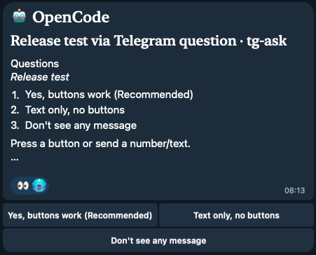

# OpenCode questions in Telegram

Bridge between OpenCode and Telegram: everything OpenCode wants to ask you goes
to the bot chat, and the answer comes straight back into the session — handy

## Demo


| What happens in OpenCode | What goes to Telegram | How to reply |
|---|---|---|
| Question via the `question` tool | question with buttons | press a button, or reply with text |
| Tool permission request | three buttons: once / always / reject | press a button |
| `ask_user_via_telegram` tool | free-form text question | reply with text |
| run finishes ("task done") | session title + the final answer text | no reply needed |
| `python3 tg-ask.py notify "…"` | just a notification | no reply needed |

How the reply looks in Telegram — the original question stays in place, the answer is appended below:

```
🤖 OpenCode
Bridge check · tg-ask

Keep the supergroup?

1) Keep the supergroup
2) Switch to a DM with the bot

✅ Accepted: Keep the supergroup
```

## Rich messages

Prompts use Telegram's rich message API (`sendRichMessage` / `rich_message.html`)
and are edited in place; "task done" notices use the same API with `rich_message.markdown`,
so headings, tables, lists and code blocks from the answer render natively.

- `<h2>🤖 OpenCode</h2>` header plus a session sub-header;
- the question itself is ordinary text;
- fenced and inline code is rendered as code blocks;
- single-choice options become an ordered list with each option's description under its label,
  multiselect becomes a checklist;
- permission resources are sent as a code block;
- reactions show state: 👀 while waiting, 👍 on answer, 👎 on timeout.

There is no plain-text fallback: if the Telegram API rejects rich messages, the send fails.

## Requirements

- OpenCode v2 (tested on 2.0.32) and its `opencode` CLI in `PATH`;
- Python 3.10+ (tested on 3.14), standard library only — `requests` not needed;
- macOS or Linux;
- a bot from [@BotFather](https://t.me/BotFather).

## Installation

### Install with OpenCode

Copy the block below into an OpenCode session — the agent will clone, configure,
and test the bridge:

```text
Install tg-ask from https://github.com/pavelveter/oc2tg.

1. Pick a permanent folder (for example ~/tg-ask) and clone the repository
   there.
2. cd into that folder and run ./install.sh.
3. Ask me for TELEGRAM_BOT_TOKEN (from @BotFather) and TELEGRAM_CHAT_ID.
   If I don't know the chat id, run `python3 tg-ask.py --whoami`, tell me to
   message the bot, then read the id from the output.
4. Put both values into .env.
5. Run ./install.sh --test and report whether the test message arrived.

Do not modify ~/.config/opencode/opencode.json; the plugin is loaded from the plugins folder.
```

### Manual install

```sh
cd /path/to/tg-ask       # the folder you cloned into

./install.sh              # on first run creates the .env template
# paste TELEGRAM_BOT_TOKEN from BotFather

python3 tg-ask.py --whoami   # write any message to the bot in DM — shows your id
# paste it into TELEGRAM_CHAT_ID

./install.sh --test       # final install + test message in Telegram
```

What `install.sh` does:

1. copies `tg-ask.ts` to `~/.config/opencode/plugins/tg-ask.ts`, substituting the actual
   path to `tg-ask.py` (the folder can be moved);
2. creates `.env` from the template if missing (doesn't fill in values);
3. runs `--selfcheck` (offline, no network);
4. runs `--check` (creds, bot, chat type);
5. with `--test` sends a check message.

No changes to `~/.config/opencode/opencode.json` are needed: plugins from the plugin
folder are picked up by OpenCode automatically and reloaded on file change.

## `.env` setup

The template is `.env.example` — `install.sh` copies it to `.env` on first run:

```ini
TELEGRAM_BOT_TOKEN=123456:AA...   # bot token from @BotFather
TELEGRAM_CHAT_ID=123456789        # where to write; your id via --whoami
```

Environment variables `TELEGRAM_BOT_TOKEN`/`TELEGRAM_CHAT_ID` take priority over `.env`.

`TG_ASK_DONE_NOTIFY` (default `YES`) sends the final answer to Telegram when a run finishes;
`NO` turns it off.

Optional tunables in the same `.env` (seconds; invalid or non-positive values fall back
to the default):

```ini
TG_ASK_TIMEOUT=900        # how long to wait for a reply in Telegram
TG_ASK_IDLE_TIMEOUT=60    # daemon exits after this much idleness
TG_ASK_HTTP_TIMEOUT=30    # one Telegram API request
TG_ASK_POLL_TIMEOUT=20    # getUpdates long poll
TG_ASK_MAX_ATTEMPTS=3     # attempts to parse a text answer
TG_ASK_MAX_INPUTS=25      # guard against an endless button loop
```

Both ends read them: the plugin takes `TG_ASK_TIMEOUT` for its own deadline, the script
the rest. A running daemon picks up changes on its next start (it exits after
`TG_ASK_IDLE_TIMEOUT` of inactivity).

**Which chat to pick.** A personal chat is more reliable: there text and buttons work
without limits. In a group the bot has Privacy mode on by default — it only sees
commands and **replies (Reply) to its own messages**, so plain text never reaches it
(buttons still work). `--check` will warn about this if you pointed at a group;
you can disable the mode in BotFather (`/setprivacy` → Disable).

## Dialog behavior

- **Buttons.** A press = an answer. The message is edited: question + `✅ Accepted: answer`,
  keyboard removed. For multiselect — toggleable `✅/⬜️` and a "Done" button.
- **Text.** Understands an option number (`2`), a label (`No`), a value, "yes/no" for boolean,
  numbers (for `number`/`integer`), "comma-separated options" for multiselect. Trailing text
  after an unambiguous choice is returned as `answers["<field>_note"]` — e.g. "3 because dangerous"
  becomes `reject` + reason.
- **Timeout** — 15 minutes by default; `TG_ASK_TIMEOUT` in `.env` (read by both `tg-ask.ts`
  and `tg-ask.py`, default 900 s).
  On expiry the form is cancelled, the permission is rejected, the session keeps running.
- **Reply in the terminal cancels the TG dialog**: the child process is stopped, the lock is
  released, the message stays in Telegram as history.
- **Task done.** When a run finishes, the session title and the final answer text go to
  Telegram as rich Markdown — headings, tables, lists, quotes and code blocks render as such.
  When the answer does not fit, whole sections continue in the next message (at most 6).
  If the final answer ends with a question, the notice becomes interactive: your reply in
  Telegram is fed back into the session and the run continues (up to 3 rounds per session).
  Enabled by default, `TG_ASK_DONE_NOTIFY=NO` turns it off. Each answer is sent once, even
  if the event fires again; subagent sessions and sessions of other directories are left to
  their own reporter.

## Checks and diagnostics

```sh
python3 tg-ask.py --selfcheck   # offline checks of answer parsing, buttons, limits
python3 tg-ask.py --check       # creds, bot access, chat type and Privacy mode
python3 tg-ask.py --whoami      # chat ids from unprocessed messages to the bot
python3 tg-ask.py notify "text"
```

Bridge log — `tg-ask.log` (JSONL, written by both ends): shows `form-ask`/`form-replied`,
`permission-ask`/`permission-replied`, `reply via: button|text`, timeouts and errors.
That the plugin loaded is visible in `~/.local/share/opencode/log/opencode.log`:
`msg="loading plugin" id=.../plugins/tg-ask.ts`.

## Environment variables

| Variable | Meaning | Default |
|---|---|---|
| `TG_ASK_SCRIPT` | path to `tg-ask.py` for the plugin | substituted by the installer |
| `TG_ASK_PYTHON` | Python interpreter | `python3` |
| `TG_ASK_OPENCODE` | CLI for replying to forms | `opencode` |
| `OPENCODE_CONFIG_DIR` | OpenCode config folder | `~/.config/opencode` |
| `TELEGRAM_THREAD_ID` | forum topic id to send into | (none) |

## Limitations

- **Multiple dialogs can run in parallel** via an ephemeral coordinator. In a personal chat a
  plain-text reply without Reply can be ambiguous when several questions are open — in that
  case reply by swiping (Reply) to the specific message.
- Fields of type `external` (OAuth links, etc.) are shown in Telegram but not filled in.
- Conditional fields (`when`) are not filtered — sent as is.
- Hidden fields (`hidden`) are skipped; if there's nothing to fill, the form stays with the terminal.

## Files

| File | Role |
|---|---|
| `tg-ask.py` | all Telegram work: dialog, buttons, reply parsing, timeouts, diagnostics |
| `tg-ask.ts` | OpenCode plugin: `form.created` and `permission.asked` → script, reply → session |
| `install.sh` | install plugin into OpenCode and checks |
| `.env` / `.env.example` | token and chat (`.env` is in `.gitignore`, `.env.example` is the template) |
| `tg-ask.log`, `.tg-ask.lock`, `.tg-ask.daemon.lock` | log and locks (generated, in `.gitignore`) |
| `tg-ask.state.json`, `tg-ask.sock` | coordinator state and Unix socket (generated, in `.gitignore`) |

## Removal

```sh
rm ~/.config/opencode/plugins/tg-ask.ts   # the folder itself is left untouched
```

## Internals (for edits)

- Permission replies go through `ctx.permission.reply({sessionID, requestID, decision})`.
- Form replies go through the CLI `opencode api post /api/session/<sid>/form/<fid>/reply`,
  because the plugin has no `session.form`: the plugin's `SessionDomain` is a `Pick`
  without forms, and the `@opencode/client`/`@opencode/schema` packages aren't imported
  from the plugin. The CLI is the supported path to the same server.
- Events are filtered by `location.directory`: the plugin loads one instance per location,
  and without filtering each question would arrive in Telegram several times.
